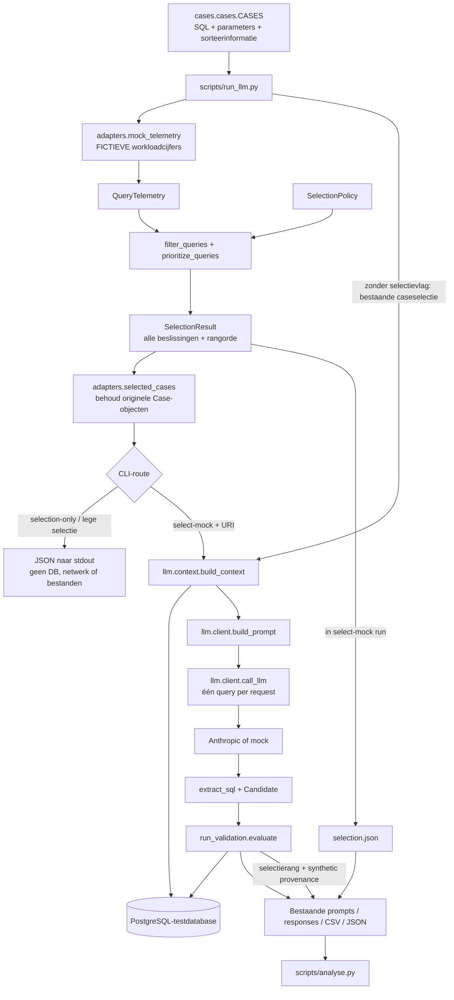

# Architectuur van de single-agent POC

## Doel en afbakening

De POC onderzoekt AI-ondersteunde optimalisatie van PostgreSQL SELECT-query's.
Eén genererende component stelt een herschrijving voor; afzonderlijke software
beoordeelt toegestane statementvorm, resultaatverschillen en performance.
Er is geen tweede agent en geen automatische LLM-feedbacklus.

De huidige uitbreiding voegt selectie vóór contextopbouw toe. De workloadcijfers
zijn **volledig gesimuleerd**. De testdatabase en bestaande SQL-cases blijven
behouden. Er is geen live telemetrycollector, PostgreSQL-monitoringconfiguratie,
AWS-integratie of automatisch indexbeheer toegevoegd.

## Componenten en verantwoordelijkheden

| Component | Verantwoordelijkheid | Afhankelijkheden |
|---|---|---|
| `cases/` | Vier originele queries, parameterfuncties, sorteerinformatie en mutanten | SQL-bestanden; database alleen bij uitvoeren van parameterfuncties |
| `query_selection/adapters.py` | Cases naar gesimuleerde aggregaten; geselecteerde IDs terug naar dezelfde Case-objecten | Contracten; Case-type alleen voor type hints |
| `query_selection/models.py` | Telemetry-, beslissing- en resultaatcontracten; JSON-weergave | Standard library, policy |
| `query_selection/policy.py` | Uitsluitingen en maximaal aantal query's | Standard library |
| `query_selection/selection.py` | Pure eligibility, deduplicatie en impactranking | Contracten, policy, sqlglot; geen database, model of validator |
| `scripts/run_llm.py` | CLI en orchestration, optionele selectiemodus, opslag | Cases, selectie; database/validator pas na offline exit |
| `llm/context.py` | Schema, indexen, plan en statistieken selecteren | sqlglot en actieve databaseverbinding |
| `llm/client.py` | Prompt, één generatieve call, SQL uit response halen | Anthropic SDK uitsluitend bij echte modelcall; mock zonder SDK |
| `validator/` en `scripts/run_validation.py` | Bestaande statische controle, resultaatvergelijking en benchmark | sqlglot, psycopg en testdatabase |
| `scripts/analyse.py` | Bestaande experimentele resultaten analyseren | CSV/JSON; matplotlib optioneel |

De modules zijn Python-namespacepakketten, overeenkomstig de bestaande repository.
Er zijn geen nieuwe runtime-dependencies toegevoegd. Tests gebruiken `unittest`.

## Componentdiagram: aangesloten code



De filterlaag heeft geen verbinding met de validator: queryselectie geeft geen
toestemming om een gegenereerd voorstel uit te voeren. De validator blijft de
bestaande afzonderlijke uitvoeringsgrens. Indexdefinities kunnen context zijn;
de huidige prompt ondersteunt geen indexvoorstellen.

## Sequentiediagram

```mermaid
sequenceDiagram
    actor User
    participant CLI as run_llm.main
    participant Adapter as Case-adapter
    participant Selection as Pure selectielaag
    participant Context as llm.context
    participant DB as Testdatabase
    participant LLM as llm.client
    participant Validator as evaluate
    participant Files as Resultaatbestanden

    User->>CLI: --selection-only OF --select-mock
    CLI->>Adapter: mock_telemetry(cases)
    Adapter-->>CLI: QueryTelemetry[] (synthetic=true)
    CLI->>Selection: select_queries(records, policy)
    Selection-->>CLI: geselecteerd + alle beslissingen
    CLI->>Adapter: selected_cases(result, cases)
    Adapter-->>CLI: originele Case-objecten in rangorde
    alt selection-only of geen geselecteerde cases
        CLI-->>User: JSON naar stdout; stop vóór I/O naar services
    else pipeline met URI
        CLI->>Files: selection.json en systeemregels
        CLI->>DB: connect + make_ctx
        loop geselecteerde case en bestaande contextcondities
            CLI->>Context: build_context(conn, case, ctx, condition)
            Context->>DB: benodigde schema/plan/statistiekqueries
            Context-->>CLI: contextblokken
            CLI->>Files: prompt
            alt bestaande dry-run
                CLI-->>User: promptinformatie; geen model of validatie
            else modelrun
                loop bestaande --reps
                    CLI->>LLM: call_llm(prompt, model, original_sql)
                    LLM-->>CLI: response + tokengebruik
                    CLI->>Files: ruwe response + geëxtraheerde SQL
                    CLI->>Validator: evaluate(conn, case, candidate, ctx, val_reps)
                    Validator->>DB: resultaatcontroles en eventueel benchmark
                    Validator-->>CLI: oordeel + gemeten performance
                end
                CLI->>Files: eindresultaten + synthetic workloadmetadata
            end
        end
    end
```

Voor leesbaarheid toont de sequentie het optionele selectiepad. Zonder
selectievlaggen slaat de CLI de adapter en selectielaag over. Eindresultaten
worden door de bestaande code na alle cases/condities geschreven.

## Invoer, koppeling en registratie

`Case.name` is voorlopig de stabiele query-ID. De adapter kopieert de originele
SQL naar het brononafhankelijke contract. Het selectieresultaat bevat geen
databaseverbindingen, functies of Case-objecten en is strict JSON-serialiseerbaar.
`selected_cases()` zoekt de originele objecten terug en controleert ID-uniqueness
en exacte SQL-overeenkomst. Daardoor blijven parameterfuncties en sorteergegevens
ongewijzigd beschikbaar voor context en validatie.

In een `--select-mock`-run wordt `selection.json` naast de bestaande bestanden
opgeslagen. Validatierijen krijgen `query_id`, `selection_rank`,
`workload_impact_ms`, `telemetry_source`, `telemetry_is_synthetic` en
`telemetry_window_id`. De fictieve workloadimpact is gescheiden van bijvoorbeeld
`orig_median_ms`, dat de bestaande benchmark meet. De bestaande analyse kan de
extra kolommen blijven negeren; zij maakt nog geen nieuwe selectievisualisatie.

## Uitvoering

Vanuit de repositoryhoofdmap, met `sqlglot` geïnstalleerd:

```powershell
python scripts/run_llm.py --selection-only --top-k 1
python -m unittest discover -s tests -v
```

De eerste opdracht leest alleen lokale bronbestanden en print JSON. Zij importeert
geen psycopg, Anthropic SDK of validatiemodule en maakt geen resultatenmap.

Met een reeds voorbereide, geïsoleerde testdatabase kan dezelfde selectie naar
de bestaande pipeline, zonder echte modelcall:

```powershell
python scripts/run_llm.py "<test-db-uri>" --select-mock --top-k 1 --conditions C2_schema --model mock --reps 1
```

Die tweede route heeft wel psycopg, de testdata en een database nodig. `--model
mock` voorkomt modelcalls, maar niet databasequeries en benchmarks. `--dry-run`
behoudt zijn oude betekenis: context verzamelen en prompts schrijven; C3/C4
kunnen dus nog steeds `EXPLAIN ANALYZE` uitvoeren.

## Bekende beperkingen en vervolg

- Mockworkloadgegevens zijn geen bewijs van databaseperformance of werkelijke
  uitvoeringsfrequenties. Er vindt geen monitoring of snapshotaggregatie plaats.
- SQLGlot controleert syntactische geschiktheid, niet objectbestaan, rechten of
  algemene semantische gelijkwaardigheid. SELECT-functies kunnen effecten of
  kosten hebben; selectie is geen securitycontrole.
- De bestaande validator is ongewijzigd. Zijn ruime `TIE_AMBIGUOUS`-acceptatie,
  mogelijke normalisatiebotsingen en beperkte parameterdekking verdienen een
  afzonderlijke wijziging met regressietests. `ACCEPTED` is geen algemeen bewijs.
- Redactie en een volledig contexttokenbudget zijn nog niet geïmplementeerd.
- De database-URI wordt niet technisch als testdoel afgedwongen. Gebruik de
  bestaande uitvoerroute uitsluitend tegen een geïsoleerde testdatabase.
- De bestaande modelstandaard en experimentele aantallen requests blijven
  behouden. `top_k` begrenst cases, niet requests over condities en herhalingen.
- Geen automatische productie-, index- of schemawijzigingen.

Een echte adapter kan later dezelfde geaggregeerde contracten leveren. De
selectielaag hoeft daarvoor niet te veranderen. Een volledige raw-eventcollector,
parameterverwerving of cumulatieve PostgreSQL-snapshotverwerking valt buiten
deze implementatie.
