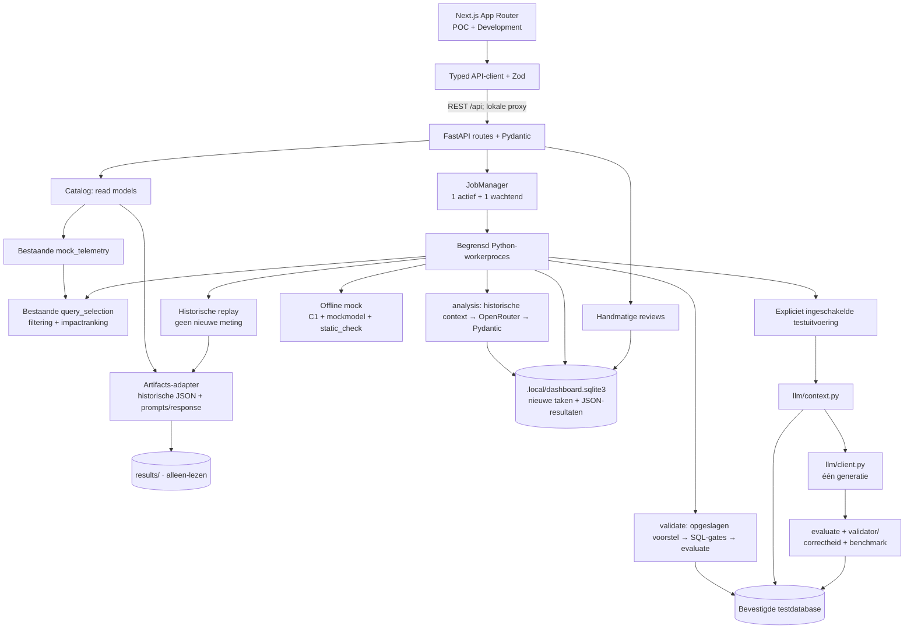

# SUE INNO — UI-architectuur

## Doel en grenzen

Eén applicatie ondersteunt een begrijpelijke POC-demonstratie en technische
ontwikkeling. Het is een onderzoeksomgeving, geen autonome DBA. Bestaande
Python-logica blijft de bron van waarheid voor selectie, generatie en validatie.
Er zijn geen extra agent, feedbacklus, microservices of cloudafhankelijkheden.

De frontend gebruikt Next.js App Router, React, strict TypeScript en Tailwind.
De lokale UI-primitives volgen shadcn/ui-compositie: Button/Slot, Card, fields
en een toegankelijke Radix Dialog zijn lokaal aanpasbaar. Lucide verzorgt iconen,
Prism SQL-highlighting en Recharts de twee inhoudelijke grafieken.

## Datastroom

Sinds 3 november is ook [gestructureerde OpenRouter-analyse](openrouter.md)
aangesloten. `analysis` vereist geen database; `validate` test het opgeslagen
voorstel afzonderlijk. De oudere live/replay-workflows hieronder blijven bestaan.



De live tak bestaat in code en wordt pas aangeboden wanneer serverconfiguratie
en dependencies aanwezig zijn. Die beschikbaarheid is geen bewijs van een
werkende verbinding of modelprovider. De demo heeft deze tak niet nodig.

## Modulestructuur

```text
api/
  app.py, config.py, routes.py, schemas.py, worker.py
  services/
    artifacts.py      # legacy parsing en conservatieve statusadaptatie
    catalog.py        # samengestelde query-, run- en evaluatieviews
    jobs.py           # begrensde processen en lifecycle
    workflows.py      # bestaande domeinfuncties combineren
    storage.py        # SQLite voor taken en reviews
    privacy.py        # redactie voor weergave en context
frontend/
  src/app/           # route-entrypoints, server-side data ophalen
  src/features/      # dashboard, queries, runs, development
  src/components/    # ui, layout, queries, pipeline, evaluation, charts, shared
  src/lib/api/       # één client, responsecontracten en datafoutafhandeling
  src/lib/config/    # centrale sidebar-navigatie
  src/hooks/         # lokale server-state en begrensde polling
  src/tests/         # component- en contracttests; geen productiedatabron
  e2e/               # echte lokale demo-smoketests
```

## Verantwoordelijkheden

| Grens             | Verantwoordelijkheid                                                                              |
| ----------------- | ------------------------------------------------------------------------------------------------- |
| Python-domein     | De bestaande selectie, context, modelcall en validator. Geen JS-kopie.                            |
| FastAPI           | Invoer valideren, bestaande functies aanroepen en typed HTTP-contracten aanbieden.                |
| Artifactadapter   | Ontbrekende data behouden als onbekend, provenance bewaren, legacy-statussen zorgvuldig vertalen. |
| API-client        | Fetch centraliseren en elke response met Zod valideren. Geen vervangende succesdata bij fouten.   |
| Domeincomponenten | Typed props renderen: SQL, fases, benchmark, context, matrix en reviews.                          |
| Features          | Componenten samenstellen en presentatie-interactie beheren.                                       |
| Routes            | Gegevens ophalen en feature kiezen; pagina's zijn onafhankelijk verwijderbaar.                    |
| Stijl             | CSS-variabelen, semantische statuskleuren en gedeelde primitives. Geen remote fonts nodig.        |

`api/schemas.py` is het HTTP-contract. De TypeScript/Zod-contracten in
`frontend/src/lib/api/contracts.ts` volgen dit expliciet. Bij contractwijzigingen
worden beide bijgewerkt; runtimevalidatie voorkomt dat afwijkende responses
stilzwijgend succesvolle waarden krijgen.

Server Components halen initiële data op. Client Components zijn beperkt tot
interactieve tabellen, charts, dialogs, SQL-copy, reviews en actieve-runstates.
Er is geen globale state manager. `useApi` pollt actieve taken; na voltooiing
stopt polling. Bij een fout is expliciete retry beschikbaar.

## Een replay starten

```mermaid
sequenceDiagram
    actor User as Gebruiker
    participant UI as Run-dialog
    participant API as FastAPI
    participant Queue as JobManager
    participant Worker as Python-worker
    participant Select as query_selection
    participant Artifacts as Historische artefacten
    participant Store as SQLite
    User->>UI: Kies case, replay en contextconditie
    UI->>API: POST /api/runs (geen SQL)
    API->>API: Case, modus, bron en prerequisites controleren
    API->>Store: PENDING + gevalideerde configuratie
    API->>Queue: vaste operatie in begrensde queue
    API-->>UI: 202 + run-ID
    Queue->>Worker: gegenereerde UUID, geen credentials in argv
    Worker->>Store: RUNNING
    Worker->>Select: mock_telemetry → select_queries → selected_cases
    Worker->>Artifacts: lees opgeslagen poging
    Artifacts-->>Worker: response, context, validator- en benchmarkvelden
    Worker->>Store: COMPLETED + resultaat met historische provenance
    loop Alleen zolang PENDING/RUNNING
        UI->>API: GET /api/runs/{id}
        API->>Store: lees status/resultaat
        API-->>UI: typed runcontract
    end
    UI-->>User: fases, SQL, metingen en beperkingen
    User->>UI: handmatige review
    UI->>API: POST feedback
    API->>Store: review apart opslaan
    Note over UI,Store: Technische resultaten blijven ongewijzigd; geen feedback naar het model
```

## Uitvoermodi en herkomst

| Modus               | Wat werkelijk gebeurt                                                                                                              |
| ------------------- | ---------------------------------------------------------------------------------------------------------------------------------- |
| Historisch          | Bestaande artefacten bekijken. Geen nieuwe uitvoering.                                                                             |
| Replay              | Nieuwe selectie en taakregistratie; historische response en metingen hergebruiken. Nul nieuwe modelrequests.                       |
| Offline mock        | Nieuwe selectie, C1-fixturecontext, bestaande mockmodelcall en statische controle. Geen DB; correctheid/benchmark niet uitgevoerd. |
| Testdatabase + mock | Bestaande context en evaluate op de bevestigde testdatabase; model geeft origineel terug.                                          |
| Live POC            | Zelfde pad met precies één expliciet toegestaan extern modelrequest.                                                               |
| AI-analyse          | Eén gestructureerd OpenRouter-request zonder database; advies blijft ongetest.                                                     |
| Voorstelvalidatie   | Afzonderlijk opgeslagen voorstel testen na SQL-gates; geen nieuw modelrequest.                                                     |

Het Explorer-budget geldt voor de getoonde selectie. Een expliciete run kiest
één fixture en past top-1-selectie toe op die gekozen subset. Iedere run bewaart
zijn eigen selectiesnapshot. Er is geen verborgen globale beleidsinstelling.

Historische tokens en requestduur blijven historische informatie in een replay.
De run rapporteert daarnaast nul nieuwe modelrequests. Tijdzone-loze historische
bestandsdatums worden als bronkloktijd getoond, met onbekende tijdzone; nieuwe
taaktimestamps worden in UTC opgeslagen en in Europe/Amsterdam weergegeven.

## Statusmodel en bewijs

Processtatus is `PENDING → RUNNING → COMPLETED / FAILED`. Afgerond betekent
verwerking gereed, niet dat een voorstel goedgekeurd is. Annuleren is niet
aangeboden: er is geen veilige user-facing cancellation geïmplementeerd.

Fases onderscheiden pending, running, passed, failed, warning, inconclusive,
skipped en error. Ontbrekende fase-duren blijven onbekend; mediane querytijd
wordt niet als totale fase-duur hergebruikt.

- `TIE_AMBIGUOUS` wordt niet als bewezen correct of sneller getoond.
- `EXEC_ERROR` blijft een uitvoeringsfout, geen aangetoond resultaatverschil.
- Een legacy-afwijzing zonder bewijsdetails blijft onbeslist.
- Een benchmark leidt alleen tot een performanceconclusie bij voldoende
  geregistreerd correctheidsbewijs. Ontbrekende velden worden niet verzonnen.
- Het oorspronkelijke validatoroordeel blijft zichtbaar naast de interpretatie.
- Bij mutatietests wordt de validator vergeleken met het auteurslabel. Een
  correct afgewezen mutant is een geslaagde test, geen goedgekeurd voorstel.

De kernvalidator is niet gewijzigd. Onzichtbare normalisatiebotsingen kunnen
niet achteraf uit oude JSON worden bewezen of gerepareerd.

## Opslag en beveiligingsgrens

Historische `results/` blijven ongewijzigd; ze worden bij API-start ingelezen.
Na nieuwe externe CLI-experimenten is een API-herstart nodig om die bestanden
te importeren. Nieuwe dashboardtaken en reviews staan apart in `.local/`, dat
door Git wordt genegeerd. Reviews wijzigen nooit technische resultaatrecords.

Eén API-worker, één actief workerproces, één wachtende taak en een taaklimiet van
300 seconden begrenzen de lokale uitvoering. Een herstart markeert onderbroken
taken als mislukt; geen stilzwijgende hervatting. Alleen vaste cases en suites
zijn toegestaan. Processen gebruiken geen shell; credentials staan niet in argv.

Live DB-connecties hebben connect-timeout 5 s, read-only default en
statement-timeout 120 s. De bestaande validator gebruikt bovendien rollback en
zijn eigen timeouts. De server moet uitsluitend een geïsoleerde testdatabase
met passende rechten configureren; de applicatie bewijst niet dat een URI
daadwerkelijk naar een niet-productieomgeving wijst.

Services binden lokaal. Hostcontrole, beperkte origins en gevalideerde JSON-invoer
beperken browsermisbruik. Er is geen authenticatiesysteem voor publieke hosting.
Secrets, URI's, e-mailadressen, UUID's, datumliterals en contextwaarden worden
beperkt in browserresponses; MCV-waarden worden verwijderd. Redactie is
conservatief en geen algemene DLP-garantie. Gebruik de synthetische testomgeving;
sluit gevoelige productiegegevens niet zonder afzonderlijke privacybeoordeling aan.
