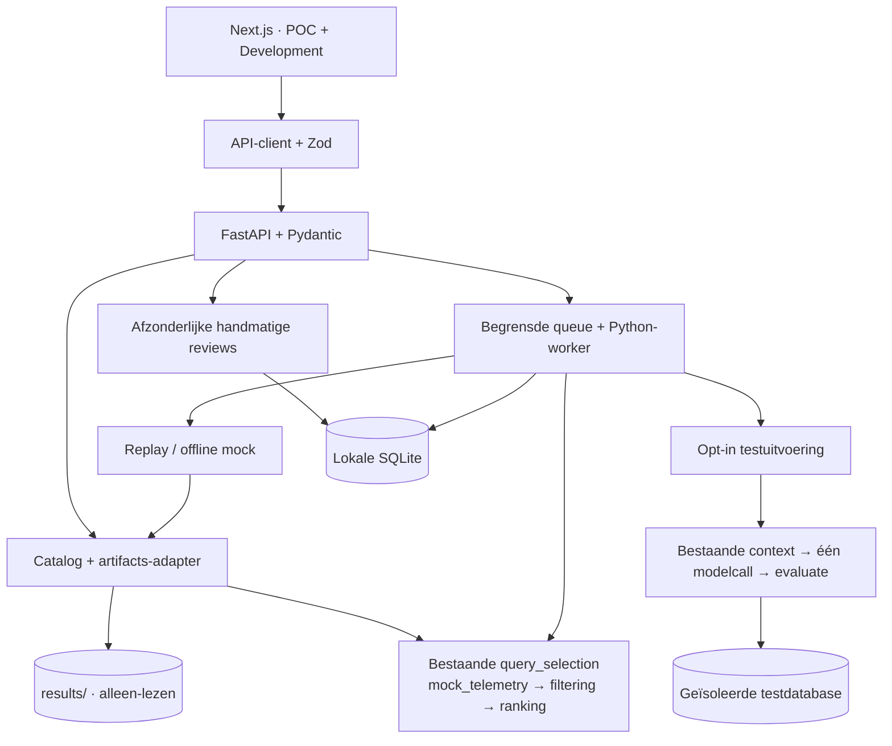

# Oplevering — SUE INNO Query Lab

Gecontroleerd op 2 november 2026 met Python 3.13.7, Node.js 22.19.0 en npm 10.9.3.
De applicatie is lokaal geïmplementeerd en getest. Er is geen publieke deployment
of commit gemaakt. De previewprocessen zijn na verificatie gestopt.

## Geleverde functionaliteit en bewijsgrens

| Onderdeel                                                      | Opleverstatus                     | Wat is geverifieerd?                                                                                                           |
| -------------------------------------------------------------- | --------------------------------- | ------------------------------------------------------------------------------------------------------------------------------ |
| Next.js App Router, strict TypeScript, React en Tailwind       | Geïmplementeerd                   | Productiebuild, typecheck, lint en componenttests slagen.                                                                      |
| Gedeelde shell, Nederlandse navigatie, licht/donker en mobiel  | Geïmplementeerd                   | Desktop visueel gecontroleerd; thema via toetsenbord; mobiele navigatie en bodybreedte in browser-smoketest.                   |
| Overzicht en Query Explorer                                    | Geïmplementeerd                   | Vier bestaande cases, echte Python-selectiebeslissingen, backendrang, zoeken, sorteren, budget en uitsluiting.                 |
| Querydetail en contextinspectie                                | Geïmplementeerd                   | SQL, bron, metrics, redencodes, historische context en correct gekoppelde pogingen. Inspectie voert geen SQL uit.              |
| Historische runs, SQL-vergelijking en benchmarks               | Historische replay                | Bronartefacten worden echt ingelezen; herhalen van een replay voert de oude metingen niet opnieuw uit.                         |
| Nieuwe offline mockrun                                         | Geïmplementeerd met mockgeneratie | Echte worker, bestaande selectie, C1-context, bestaande mockmodelcall en static check. Geen correctness- of performancemeting. |
| Development-testmatrix en individuele details                  | Geïmplementeerd                   | Historische mutanten, modelrecords, context-only records en nieuwe unittestresultaten worden apart geclassificeerd.            |
| LLM/contextvergelijking                                        | Historische resultaten            | C1–C4, uitkomsten, no-ops, tokens, requestduur en unieke cases waar vastgelegd. Geen verzonnen kostenraming.                   |
| Nieuwe offline tests starten                                   | Geïmplementeerd                   | Allowlisted unittest-suite echt via worker uitgevoerd; individuele resultaten en fouten zijn inspecteerbaar.                   |
| Handmatige feedback                                            | Geïmplementeerd                   | SQLite-opslag, ophalen na herladen en behoud van de technische uitslag, ook bij een afwijkend reviewlabel.                     |
| Queue, timeout en herstel                                      | Geïmplementeerd                   | Eén actief en één wachtend proces; timeout, interrupted-job recovery en ontbrekend workerresultaat getest.                     |
| Testdatabase + mock en echte live generatie                    | Gedeeltelijk geverifieerd         | Bestaande Python-functies zijn aangesloten; compositie met substitutes getest. Geen echte database/provider uitgevoerd.        |
| Querytelemetrie                                                | Gesimuleerd                       | Bestaande adapter gebruikt fictieve workloadcijfers; die staan los van historische benchmarkmetingen.                          |
| Echte telemetrycollector, indexbeheer en production deployment | Niet geïmplementeerd              | Buiten deze wijziging. Geen automatische DDL, tweede agent of model-feedbacklus.                                               |

## Definitieve structuur

```text
initial_poc_sue/
├── api/
│   ├── app.py, config.py, routes.py, schemas.py, worker.py
│   └── services/
│       ├── artifacts.py, catalog.py, privacy.py
│       └── jobs.py, storage.py, workflows.py
├── frontend/
│   ├── src/
│   │   ├── app/                  # POC- en Development-routes
│   │   ├── components/           # ui, layout, queries, pipeline, evaluation, charts
│   │   ├── features/             # dashboard, queries, runs, development
│   │   ├── lib/api/              # HTTP-client, Zod-contracten, datafoutafhandeling
│   │   ├── lib/config/           # centrale navigatie
│   │   ├── hooks/, tests/, types/
│   │   └── lib/formatters.ts, utils.ts
│   ├── e2e/demo.spec.ts
│   └── package.json, package-lock.json, overige configuratie
├── cases/, query_selection/, llm/, validator/, scripts/, results/  # behouden
├── tests/                        # bestaande 36 + 30 nieuwe Python-tests
├── docs/ui-*.md
├── requirements-api.txt, requirements-dev.txt
└── .env.example
```

Gegenereerde dependencies, buildbestanden, screenshots en lokale SQLite-data
worden door Git genegeerd. De volledige bronbestandenlijst staat onderaan.

## Werkelijke architectuur



De uitgebreide component- en sequencediagrammen staan in
[ui-architecture.md](ui-architecture.md). Er is geen browserafhankelijkheid op
Python-implementatiedetails of providercredentials. De live tak blijft opt-in;
het aanwezig zijn van configuratie is geen geslaagde verbindingscontrole.

## Lokaal starten en demonstreren

De dependencies zijn in deze workspace geïnstalleerd. Op een schone checkout:

```powershell
# Vanuit de repositoryhoofdmap:
python -m venv .venv
.\.venv\Scripts\python.exe -m pip install -r requirements-dev.txt
cd frontend
npm ci
cd ..
```

Start in terminal 1, vanuit de repositoryhoofdmap:

```powershell
.\.venv\Scripts\python.exe -m uvicorn api.app:app --host 127.0.0.1 --port 8000
```

Start in terminal 2, vanuit dezelfde hoofdmap:

```powershell
cd frontend
npm run dev
```

- POC: <http://127.0.0.1:3000>.
- Query Explorer: <http://127.0.0.1:3000/queries>.
- Pipeline-runs: <http://127.0.0.1:3000/runs>.
- Development: <http://127.0.0.1:3000/development>.
- Architectuur: <http://127.0.0.1:3000/development/architecture>.
- API-documentatie: <http://127.0.0.1:8000/docs>.

Demonstratie: inspecteer `top_products`, sluit die tijdelijk uit in Query Explorer,
herstel de selectie en start via **Demo starten** een **Historische replay**.
Bekijk de fases, SQL en historische benchmark, sla een review op en herlaad.
Open vervolgens Development, inspecteer de gemiste `M3_geen_id_tiebreak`-mutant
en voer de offline filtering/ranking-tests uit. De demo vereist geen credentials.

Zie [ui-development.md](ui-development.md) voor configuratie, productiebuild,
alle uitvoermodi, Windows-details en troubleshooting. Het weergavebudget in
Explorer is geen globale instelling: een expliciete run selecteert top-1 uit
de door de gebruiker gekozen case en bewaart een eigen selectiesnapshot.

## Uitgevoerde controles

| Controle                                                            | Resultaat                                                                                            |
| ------------------------------------------------------------------- | ---------------------------------------------------------------------------------------------------- |
| `python -B -m unittest discover -s tests -v`                        | 66 tests geslaagd, inclusief de oorspronkelijke 36.                                                  |
| Ruff check en format check voor `api/` en vier nieuwe testbestanden | Geslaagd; 15 Python-bestanden gecontroleerd.                                                         |
| `npm ci --offline --no-audit --no-fund`                             | Installatie vanaf lockbestand geslaagd met aanwezige npm-cache.                                      |
| `npm run typecheck`                                                 | Geslaagd.                                                                                            |
| `npm run lint`                                                      | Geslaagd.                                                                                            |
| `npm test`                                                          | 20 tests geslaagd in 4 testbestanden.                                                                |
| `npm run build`                                                     | Geslaagde geoptimaliseerde productiebuild voor alle routes.                                          |
| `npm run test:e2e` met geïnstalleerde Edge                          | 4 browserflows geslaagd in 26,9 seconden tegen de productiebuild en FastAPI.                         |
| Behoud bestaande modules en resultaten                              | `git diff --exit-code` op domeinmodules, scripts, cases en historische resultaten: geen wijzigingen. |
| `git diff --check`                                                  | Geen whitespacefouten.                                                                               |

De browserflows controleren selectie/uitsluiting, replay en persistente review,
Development-inspectie en echte offline testuitvoering, mobiele navigatie op
390 pixels, en eerlijke API-foutafhandeling. Screenshots zijn lokaal bewaard in
`frontend/test-results/overview-desktop.png` en `development-desktop.png`.
API-/browsertests en de finale build moesten buiten de beperkte Windows-sandbox
lopen; de sandbox blokkeerde respectievelijk asyncio/socketpair en buildworkers.

Er zijn geen betaalde modelrequests, AWS-acties of echte databasebenchmarks
uitgevoerd. De live-integratietest gebruikt substitutes; zij bewijst aansluiting
van functies, geen werking van een echte database of modelprovider.

## Beperkingen en technische schuld

- De bestaande validator is bewust ongewijzigd. Tie-ambiguïteit, normalisatie-
  botsingen en foutclassificatie verdienen eigen domeinfixes met regressietests.
  De API behandelt zichtbaar ambigu bewijs conservatief en bewaart het ruwe oordeel.
- Historische acceptatie geldt binnen geregistreerde testvoorwaarden. Een
  browserweergave kan ontbrekend bewijs niet reconstrueren.
- Nieuwe live SQL-/modeluitvoering vereist aparte verificatie op een bevestigde
  testdatabase. Tot die tijd is deze tak gedeeltelijk geverifieerd.
- Workloadimpact blijft fictief; er is geen PostgreSQL-monitoring of collector.
- Redactie is best effort en geen algemene DLP-garantie. Gebruik synthetische data.
- De uitvoering is lokaal, zonder multi-user auth of publieke hosting. Er is geen
  user-facing annulering; een worker heeft wel een begrensde looptijd.
- Historische imports worden bij startup gelezen; herstart na externe CLI-runs.
  Lokale taaklijsten zijn begrensd op 500 records en hebben nog geen paginering.
- Themawisseling geldt voor de huidige applicatiesessie en is geen opgeslagen
  gebruikersvoorkeur. De API-contracten worden expliciet in Python en Zod bijgehouden.
- ESLint 9 is gekozen vanwege de peercompatibiliteit met de Next.js-configuratie;
  npm meldt de deprecatie van deze major. Een compatibele toolingupgrade blijft onderhoud.

## Aanbevolen vervolgstappen

1. Herstel tie-afhandeling, normalisatie en uitvoeringsfoutclassificatie in de
   kernvalidator met gerichte regressietests. Dit is de eerste prioriteit vóór
   sterkere uitspraken over correcte SQL-voorstellen.
2. Verifieer testdatabase + mockmodel op een geïsoleerde fixtureomgeving; daarna
   één expliciet geautoriseerde echte modelcall met gecontroleerde kosten/context.
3. Voeg een echte telemetry-adapter toe achter het bestaande selectiecontract.
   Breid pas daarna monitoring, paginering of indexadvies uit wanneer nodig.
4. Genereer bij verdere API-groei het frontendcontract uit OpenAPI en actualiseer
   de linttooling wanneer de framework-peerdependencies dat ondersteunen.

## Nieuwe en gewijzigde bestanden

De onderstaande manifestlijst beschrijft deze dashboardwijziging. Bestaande
domeinmodules en historische artefacten vallen er niet onder.

Gewijzigd (2):

```text
.gitignore
README.md
```

Nieuw (92):

```text
.env.example
api/app.py
api/config.py
api/routes.py
api/schemas.py
api/services/artifacts.py
api/services/catalog.py
api/services/jobs.py
api/services/privacy.py
api/services/storage.py
api/services/workflows.py
api/worker.py
docs/ui-architecture.md
docs/ui-delivery.md
docs/ui-development.md
docs/ui-extension-guide.md
frontend/.env.example
frontend/.prettierignore
frontend/components.json
frontend/e2e/demo.spec.ts
frontend/eslint.config.mjs
frontend/next-env.d.ts
frontend/next.config.ts
frontend/package-lock.json
frontend/package.json
frontend/playwright.config.ts
frontend/postcss.config.mjs
frontend/src/app/development/architecture/page.tsx
frontend/src/app/development/page.tsx
frontend/src/app/development/tests/[id]/page.tsx
frontend/src/app/error.tsx
frontend/src/app/globals.css
frontend/src/app/layout.tsx
frontend/src/app/loading.tsx
frontend/src/app/not-found.tsx
frontend/src/app/page.tsx
frontend/src/app/queries/[id]/page.tsx
frontend/src/app/queries/page.tsx
frontend/src/app/runs/[id]/page.tsx
frontend/src/app/runs/page.tsx
frontend/src/components/charts/condition-chart.tsx
frontend/src/components/charts/impact-chart.tsx
frontend/src/components/evaluation/attempt-panels.tsx
frontend/src/components/evaluation/feedback-form.tsx
frontend/src/components/evaluation/test-matrix.tsx
frontend/src/components/layout/app-shell.tsx
frontend/src/components/pipeline/architecture-diagram.tsx
frontend/src/components/pipeline/pipeline-visualizer.tsx
frontend/src/components/pipeline/run-table.tsx
frontend/src/components/queries/query-decision.tsx
frontend/src/components/queries/query-table.tsx
frontend/src/components/queries/sql-viewer.tsx
frontend/src/components/shared/json-inspector.tsx
frontend/src/components/shared/page-header.tsx
frontend/src/components/shared/states.tsx
frontend/src/components/shared/status.tsx
frontend/src/components/ui/button.tsx
frontend/src/components/ui/card.tsx
frontend/src/components/ui/dialog.tsx
frontend/src/components/ui/fields.tsx
frontend/src/features/dashboard/overview.tsx
frontend/src/features/development/architecture.tsx
frontend/src/features/development/development-center.tsx
frontend/src/features/development/test-detail.tsx
frontend/src/features/development/test-launcher.tsx
frontend/src/features/queries/query-detail.tsx
frontend/src/features/queries/query-explorer.tsx
frontend/src/features/runs/run-detail.tsx
frontend/src/features/runs/run-list.tsx
frontend/src/features/runs/start-run.tsx
frontend/src/hooks/use-api.ts
frontend/src/lib/api/client.ts
frontend/src/lib/api/contracts.ts
frontend/src/lib/api/load-page.ts
frontend/src/lib/config/navigation.ts
frontend/src/lib/formatters.ts
frontend/src/lib/utils.ts
frontend/src/tests/api-client.test.ts
frontend/src/tests/domain-components.test.tsx
frontend/src/tests/fixtures.ts
frontend/src/tests/formatters.test.ts
frontend/src/tests/review-and-navigation.test.tsx
frontend/src/tests/setup.ts
frontend/src/types/prism.d.ts
frontend/tsconfig.json
frontend/vitest.config.ts
requirements-api.txt
requirements-dev.txt
tests/test_api_artifacts.py
tests/test_dashboard_api.py
tests/test_dashboard_jobs.py
tests/test_dashboard_workflows.py
```
